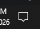
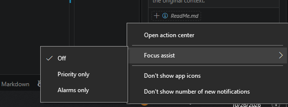

### Resources:

1. https://chatgpt.com/c/6ad9a9ec-a150-83ec-b573-9681fd1489bf
2. https://gemini.google.com/app/b1810beffd1565b0
3. https://claude.ai/chat/74cd8e62-ee38-46ca-ae87-cecd20598a66

---

1. Write the following command in the terminal

```cmd
mkdir Global-AI-Notifier
cd Global-AI-Notifier
npm init -y
npm install node-notifier chokidar
```

2. Windows powershell open koro r following command ta run koro

```cmd
Install-Module -Name BurntToast -Force -Scope CurrentUser
```

3. Create a file named `watcher.js` inside the folder `Global-AI-Notifier`

4. `watcher.js` e nicher code ta likho:

```js
// watcher.js
const fs = require('fs');
const path = require('path');
const { exec } = require('child_process');
const chokidar = require('chokidar');

// ১. BurntToast দিয়ে Windows Native Toast Banner পাঠানোর ফাংশন
function sendGlobalToast(title, message) {
  const cleanTitle = title.replace(/"/g, '`"');
  const cleanMessage = message.replace(/"/g, '`"');

  // PowerShell Array Syntax ব্যবহার করে সঠিক কমান্ড ট্রিগার করা
  const command = `powershell -ExecutionPolicy Bypass -Command "New-BurntToastNotification -Text @(\\"${cleanTitle}\\", \\"${cleanMessage}\\")"`;

  exec(command, (err) => {
    if (err) {
      console.error('❌ BurntToast Error:', err);
    }
  });

  console.log(`🔔 [BurntToast Banner Sent]: ${title} - ${message}`);
}

// ২. লগের ফোল্ডার ও ফাইল প্যাথ
const watchFolder = 'C:\\Global-AI-Notifier\\logs';
const targetFile = path.join(watchFolder, 'terminal.log');

// ফোল্ডার না থাকলে স্বয়ংক্রিয়ভাবে তৈরি করা
if (!fs.existsSync(watchFolder)) {
  fs.mkdirSync(watchFolder, { recursive: true });
}

console.log(`👀 Background watcher is running...`);
console.log(`📄 Monitoring log file: ${targetFile}`);

// ৩. ফাইল কনটেন্ট পড়া এবং প্রসেস করা
function processFileContent(filePath) {
  setTimeout(() => {
    fs.readFile(filePath, 'utf8', (err, data) => {
      if (err) {
        console.error('❌ Error reading log file:', err);
        return;
      }

      const logText = data.trim();
      if (!logText) return;

      console.log(`\n📥 Log Content Detected:\n"${logText}"`);

      const textLower = logText.toLowerCase();

      // আরও নমনীয় ও আপডেট করা কিওয়ার্ড ম্যাচিং লজিক
      if (textLower.includes('success') || textLower.includes('complete') || textLower.includes('finished')) {
        sendGlobalToast('Task Successful', 'Terminal task completed successfully!');
      } 
      else if (textLower.includes('y/n') || textLower.includes('?') || textLower.includes('allow') || textLower.includes('confirm') || textLower.includes('proceed')) {
        sendGlobalToast('Input Required', 'Terminal is waiting for your permission/input.');
      } 
      else if (textLower.includes('error') || textLower.includes('failed') || textLower.includes('exception')) {
        sendGlobalToast('Task Error', 'An error was logged in terminal output.');
      }
    });
  }, 100);
}

// ৪. Chokidar File Watcher
const watcher = chokidar.watch(targetFile, { 
  persistent: true,
  usePolling: true,
  interval: 100
});

watcher.on('add', (filePath) => processFileContent(filePath));
watcher.on('change', (filePath) => processFileContent(filePath));
```

5. Write the following command in any terminal to run it in background from any project

```cmd
npm install -g pm2 pm2-windows-startup
pm2-startup install
pm2 start "C:\Global-AI-Notifier\watcher.js" --name "ai-terminal-notifier"
pm2 save
```

6. If the popup notification does not show then right click on the notification icon, click on focus assist dropdown and select off

