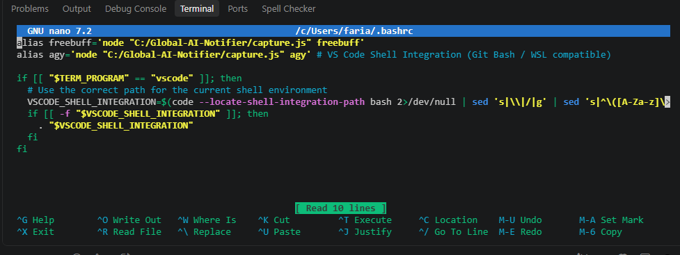

### Resources:

1. https://chatgpt.com/c/6ad9a9ec-a150-83ec-b573-9681fd1489bf
2. https://gemini.google.com/app/b1810beffd1565b0
3. https://claude.ai/chat/74cd8e62-ee38-46ca-ae87-cecd20598a66

---

1. Write the following command in the terminal

```cmd
mkdir Global-AI-Notifier
cd Global-AI-Notifier
npm init -y
npm install node-notifier chokidar
```

2. Windows powershell open koro r following command ta run koro

```cmd
Install-Module -Name BurntToast -Force -Scope CurrentUser
```

3. Create two files named `agy-watcher.js` and `freebuff-watcher.js` inside the folder `Global-AI-Notifier`

4. `freebuff-watcher.js` e nicher code ta likho:

```js
const chokidar = require("chokidar");
const fs = require("fs");
const notifier = require("node-notifier");

const logFilePath = "C:\\Global-AI-Notifier\\logs\\freebuff_logger.log";

console.log(
  `[Watcher Engine Started] Monitoring terminal logs: ${logFilePath}`,
);

let lastFileSize = 0;
let idleTimer = null;
let isProcessing = false; // Tracks if AI is currently thinking/working
let notificationTriggered = false; // Prevents repeated notifications on idle

if (fs.existsSync(logFilePath)) {
  lastFileSize = fs.statSync(logFilePath).size;
}

function triggerSuccessNotification(title, message) {
  if (notificationTriggered) return;

  notificationTriggered = true;
  isProcessing = false;
  clearTimeout(idleTimer);

  // Terminal beep sound
  process.stdout.write("\x07");

  notifier.notify(
    {
      title: title,
      message: message,
      sound: true,
      wait: false,
      icon: "C:\\Global-AI-Notifier\\freebuff-logo.png",
      appID: "Global AI Notifier",
    },
    (err) => {
      if (!err) {
        console.log(`\n[Notification Sent] Triggered by: ${title}`);
      }
    },
  );
}

chokidar
  .watch(logFilePath, {
    persistent: true,
    usePolling: true,
    interval: 300,
  })
  .on("change", (filePath) => {
    fs.stat(filePath, (err, stats) => {
      if (err) return;

      // Reset state if log is cleared for a new session
      if (stats.size < lastFileSize) {
        lastFileSize = 0;
        isProcessing = false;
        notificationTriggered = false;
        clearTimeout(idleTimer);
        console.log("\n[Watcher] New session detected. Resetting state.");
      }

      if (stats.size === lastFileSize) return;

      const stream = fs.createReadStream(filePath, {
        start: lastFileSize,
        end: stats.size,
        encoding: "utf8",
      });

      let newContent = "";
      stream.on("data", (chunk) => {
        newContent += chunk;
      });

      stream.on("end", () => {
        lastFileSize = stats.size;
        if (!newContent.trim()) return;

        const cleanContent = newContent
          .replace(/\x1B\[[0-9;]*[a-zA-K]/g, "")
          .toLowerCase();

        // Detect active processing state
        if (
          cleanContent.includes("thinking") ||
          cleanContent.includes("working") ||
          cleanContent.includes("starting your model session")
        ) {
          isProcessing = true;
          notificationTriggered = false; // Reset lock for the current task
          clearTimeout(idleTimer);
        }

        // Only evaluate end triggers if the model was actively processing
        if (isProcessing && !notificationTriggered) {
          // 1. Direct Pattern Match on Task Completion
          if (
            cleanContent.includes("some questions for you") ||
            cleanContent.includes("question for you") ||
            cleanContent.includes("do you want to") ||
            cleanContent.includes("would you like to") ||
            cleanContent.includes("once you confirm") ||
            cleanContent.includes("please confirm") ||
            cleanContent.includes("which of these should i") ||
            cleanContent.includes("do you want me to") ||
            cleanContent.includes("do you want me to continue")
          ) {
            triggerSuccessNotification(
              "❓ Freebuff: Question for You",
              "AI is waiting for your input or response!",
            );
          } else if (cleanContent.includes("✕ end session")) {
            triggerSuccessNotification(
              "✅ Freebuff: Task Finished",
              "Task completed. Enter a new coding task.",
            );
          } else {
            // 2. Idle Backup: Trigger if output stops for 3 seconds after active response
            clearTimeout(idleTimer);
            idleTimer = setTimeout(() => {
              if (isProcessing && !notificationTriggered) {
                triggerSuccessNotification(
                  "Terminal Idle After Work",
                  "No activity detected for 3 seconds.",
                );
              }
            }, 3000);
          }
        }
      });

      stream.on("error", (streamErr) => {
        console.error("[Stream Error]", streamErr.message);
      });
    });
  });
```

5. `agy-watcher.js` e nicher code ta likho:

```js
const chokidar = require("chokidar");
const fs = require("fs");
const notifier = require("node-notifier");

const logFilePath = "C:\\Global-AI-Notifier\\logs\\agy_logger.log";

console.log(
  `[Watcher Engine Started] Monitoring terminal logs: ${logFilePath}`,
);

let lastFileSize = 0;
let idleTimer = null;
let isProcessing = false; // Tracks if AI is currently thinking/working
let notificationTriggered = false; // Prevents repeated notifications on idle

if (fs.existsSync(logFilePath)) {
  lastFileSize = fs.statSync(logFilePath).size;
}

function triggerSuccessNotification(title, message) {
  if (notificationTriggered) return;

  notificationTriggered = true;
  isProcessing = false;
  clearTimeout(idleTimer);

  // Terminal beep sound
  process.stdout.write("\x07");

  notifier.notify(
    {
      title: title,
      message: message,
      sound: true,
      wait: false,
      icon: "C:\\Global-AI-Notifier\\agy-logo.png",
      appID: "Global AI Notifier",
    },
    (err) => {
      if (!err) {
        console.log(`\n[Notification Sent] Triggered by: ${title}`);
      }
    },
  );
}

chokidar
  .watch(logFilePath, {
    persistent: true,
    usePolling: true,
    interval: 300,
  })
  .on("change", (filePath) => {
    fs.stat(filePath, (err, stats) => {
      if (err) return;

      // Reset state if log is cleared for a new session
      if (stats.size < lastFileSize) {
        lastFileSize = 0;
        isProcessing = false;
        notificationTriggered = false;
        clearTimeout(idleTimer);
        console.log("\n[Watcher] New session detected. Resetting state.");
      }

      if (stats.size === lastFileSize) return;

      const stream = fs.createReadStream(filePath, {
        start: lastFileSize,
        end: stats.size,
        encoding: "utf8",
      });

      let newContent = "";
      stream.on("data", (chunk) => {
        newContent += chunk;
      });

      stream.on("end", () => {
        lastFileSize = stats.size;
        if (!newContent.trim()) return;

        const cleanContent = newContent
          .replace(/\x1B\[[0-9;]*[a-zA-K]/g, "")
          .toLowerCase();

        // Detect active processing state
        if (
          cleanContent.includes("generating...") ||
          cleanContent.includes("running command...") ||
          cleanContent.includes("reading files...") ||
          cleanContent.includes("working...") ||
          cleanContent.includes("editing files...") ||
          cleanContent.includes("reading file...") ||
          cleanContent.includes("editing file...")
        ) {
          isProcessing = true;
          notificationTriggered = false; // Reset lock for the current task
          clearTimeout(idleTimer);
        }

        // Only evaluate end triggers if the model was actively processing
        if (isProcessing && !notificationTriggered) {
          // 1. Direct Pattern Match on Task Completion
          if (
            cleanContent.includes("run this command?") ||
            cleanContent.includes("allow creation of this file?") ||
            cleanContent.includes("accept this file edit?")
          ) {
            triggerSuccessNotification(
              "⚠️ Agy: Permission Required",
              "Action blocked due to permission or access restriction.",
            );
          } else if (cleanContent.includes("question 1/")) {
            triggerSuccessNotification(
              "❓ Agy: Question for You",
              "AI is waiting for your input or response!",
            );
          } else if (cleanContent.includes("? for shortcuts")) {
            triggerSuccessNotification(
              "✅ Agy: Task Finished",
              "Task completed. Enter a new coding task.",
            );
          } else {
            // 2. Idle Backup: Trigger if output stops for 3 seconds after active response
            clearTimeout(idleTimer);
            idleTimer = setTimeout(() => {
              if (isProcessing && !notificationTriggered) {
                triggerSuccessNotification(
                  "Terminal Idle After Work",
                  "No activity detected for 3 seconds.",
                );
              }
            }, 3000);
          }
        }
      });

      stream.on("error", (streamErr) => {
        console.error("[Stream Error]", streamErr.message);
      });
    });
  });
```

7. `capture.js` e nicher code ta likhun git bash er jonno

```js
const pty = require("node-pty");
const fs = require("fs");
const path = require("path");

const command = process.argv[2];
const args = process.argv.slice(3);
const logDir = "C:\\Global-AI-Notifier\\logs";

if (!command) {
  console.error("No command specified.");
  process.exit(1);
}

if (!fs.existsSync(logDir)) {
  fs.mkdirSync(logDir, { recursive: true });
}

// Select dedicated log file based on command name
let specificLogName = "terminal_fallback.log";
if (command.toLowerCase().includes("freebuff")) {
  specificLogName = "freebuff_logger.log";
} else if (command.toLowerCase().includes("agy")) {
  specificLogName = "agy_logger.log";
}

const logFile = path.join(logDir, specificLogName);

// FRESH START: Clear specific log immediately on new session start
try {
  fs.writeFileSync(logFile, "", "utf8");
} catch (e) {}

// Git Bash er path (jodi standard path-e Git thake) ebong bash.exe spawn kora
const bashPath = "C:\\Program Files\\Git\\bin\\bash.exe";
const shellToUse = fs.existsSync(bashPath) ? bashPath : "cmd.exe";

// Spawn pseudo terminal (Git Bash / Bash or fallback to cmd.exe)
const ptyProcess = pty.spawn(
  shellToUse,
  shellToUse.includes("bash.exe")
    ? ["-c", `${command} ${args.join(" ")}`]
    : ["/c", command, ...args],
  {
    name: "xterm-color",
    cols: process.stdout.columns || 80,
    rows: process.stdout.rows || 30,
    cwd: process.cwd(),
    env: process.env,
  },
);

// LIVE LOGGING: Write output to the specific log file and render to screen
ptyProcess.onData((data) => {
  const cleanText = data.replace(/\x1B\[[0-9;]*[a-zA-K]/g, "");
  try {
    fs.appendFileSync(logFile, cleanText, "utf8");
  } catch (e) {}
  process.stdout.write(data);
});

// USER INPUT HANDLING
if (process.stdin.isTTY) {
  process.stdin.setRawMode(true);
}

process.stdin.on("data", (key) => {
  if (key.toString() === "\u0003") {
    // Ctrl+C
    ptyProcess.kill();
    process.exit();
  }
  try {
    ptyProcess.write(key);
  } catch (e) {}
});

ptyProcess.onExit(({ exitCode }) => {
  process.exit(exitCode);
});
```

8. Write the following command in any terminal to run it in background from any project

```cmd
npm install -g pm2 pm2-windows-startup
pm2-startup install
pm2 start "C:\Global-AI-Notifier\freebuff-watcher.js" --name "freebuff-watcher"
pm2 start "C:\Global-AI-Notifier\agy-watcher.js" --name "agy-watcher"
pm2 save
```

8. Write the following command in the terminal to print text inside the TUI in the log

```cmd
npm install node-pty
```

8. If the popup notification does not show then right click on the notification icon, click on focus assist dropdown and select off


9. VS Code er powershell diye ja likhbo ta e jaate log e dekhay:

  1. VS Code-এর টার্মিনালের একদম উপরে ডান কোণায় + (Plus) আইকনের পাশে ছোট Down Arrow (˅)-তে ক্লিক করুন।
  2. Select Default Profile-এ ক্লিক করুন।
  3. Jodi Select Default Profile e Powershell select na kora jay tahole:
    1. VS Code-এ `Ctrl + Shift + P` চাপুন (Command Palette ওপেন হবে)।
    2. টাইপ করুন: `Preferences: Open User Settings (JSON)` এবং `Enter` দিন।
    3. File e `terminal.integrated.defaultProfile.windows` search korun r er value `PowerShell` din
  4. লিস্ট থেকে PowerShell সিলেক্ট করে দিন।
  5. VS Code-এ `Ctrl + ,` চাপুন (Settings খুলবে)।
  6. সার্চ বারে লিখুন: `terminal.integrated.profiles.windows`
  7. `"Edit in settings.json"`-এ ক্লিক করুন।
  8. আপনার `settings.json` ফাইলের ভেতরে `terminal.integrated.profiles.windows` সেকশনে PowerShell-এর জন্য args খালি বা সঠিক আছে কিনা তা নিশ্চিত করুন (যেন -NoProfile ফ্ল্যাগ না থাকে):

  ```json
  "terminal.integrated.profiles.windows": {
    "PowerShell": {
        "source": "PowerShell",
        "icon": "terminal-powershell"
    },
    "Command Prompt": {
        "path": [
            "${env:windir}\\Sysnative\\cmd.exe",
            "${env:windir}\\System32\\cmd.exe"
        ],
        "args": [],
        "icon": "terminal-cmd"
    },
    "Git Bash": {
        "source": "Git Bash",
        "icon": "terminal-git-bash"
    }
}
  ```

  8. VS Code-এর PowerShell টার্মিনালে এই কমান্ডটি লিখে Enter দিন: `notepad $PROFILE`
  9. erpor likhun

  ```cmd
# Set execution policy
Set-ExecutionPolicy -ExecutionPolicy Unrestricted -Scope CurrentUser -Force

# Log directory setup
$globalLogDir = "C:\Global-AI-Notifier\logs"
if (-not (Test-Path $globalLogDir)) { 
    New-Item -ItemType Directory -Path $globalLogDir -Force | Out-Null 
}

# --- CLI Wrappers using Node-PTY (capture.js) ---

function agy {
    node "C:\Global-AI-Notifier\capture.js" agy $args
}

function freebuff {
    node "C:\Global-AI-Notifier\capture.js" freebuff $args
}
``` 
  10. প্রোফাইলটি ম্যানুয়ালি লোড করে টেস্ট করুন: `. $PROFILE`

11. VS code er git bash theke kaaj korar jonno Git bash k default terminal e set korte hobe

12. Erpor vs code er git bash terminal theke nicher command likho

```cmd
nano ~/.bashrc
```

12. Oi terminal er agey nicher 2ta line add koro r add kore obosshoi space diyo

```cmd
alias freebuff='node "C:/Global-AI-Notifier/capture.js" freebuff'
alias agy='node "C:/Global-AI-Notifier/capture.js" agy'
```



13. Eta save korar jonno `ctrl + s` and exit korar jonno `ctrl+ x` press koro
14. Erpor vs code er git bash terminal e nicher command ta likho:

```cmd
source ~/.bashrc
```

15. If you do any changes in the agy-watcher.js, restart the background system by writing down the following command in the terminal

```cmd
pm2 restart agy-watcher
```

16. If you do any changes in the freebuff-watcher.js, restart the background system by writing down the following command in the terminal

```cmd
pm2 restart freebuff-watcher
```

17. powershell er version check korar jonno nicher command ta likhun powershell e:

```cmd
$PSVersionTable.PSVersion
```

18. pm2 er list check korar jonno nicher command ta likhun

```cmd
pm2 list
```

1.  pm2 theke delete korar jonno nicher command ta likhun

```cmd
pm2 delete ai-notifier
```